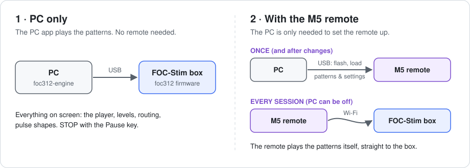
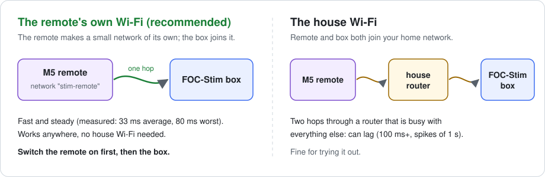
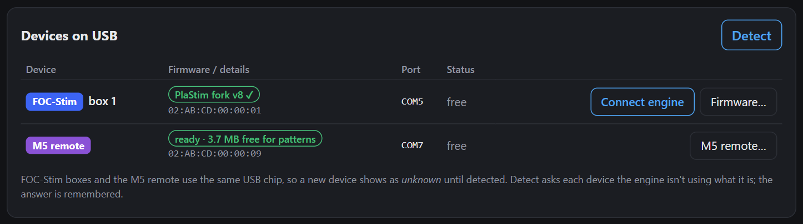
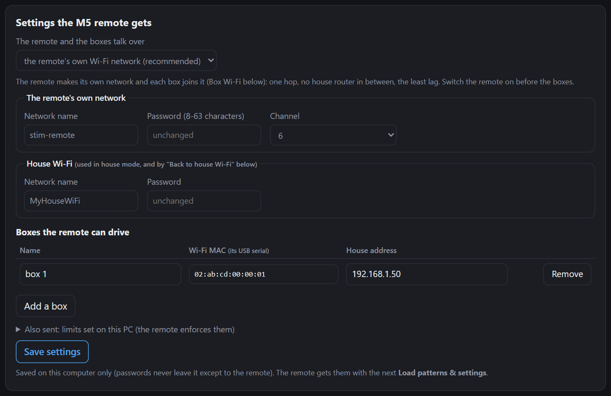
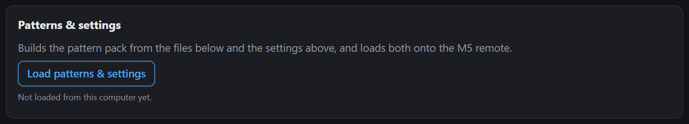
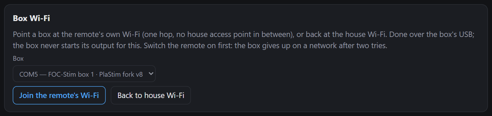

# PlaStim foc312 M5 remote

A handheld controller for **FOC-Stim** boxes running the [foc312](https://github.com/plastim/foc312) firmware. It
plays the same ET-312-style patterns as the [PlaStim foc312 engine](https://github.com/plastim/foc312-engine),
with no computer needed, straight to the box over Wi-Fi.

It runs on the **OSSM M5 Remote** hardware by ortlof: an M5Stack CoreS3 SE on a carrier with four encoders and a
button. Build or buy one from **[ortlof/OSSM-M5-Remote](https://github.com/ortlof/OSSM-M5-Remote)**; this repository
is its firmware for e-stim (written from scratch; the hardware design is ortlof's).
It also runs on the **RADR**, R+D's wireless remote, for patterns ([The RADR hardware](#the-radr-hardware)).

> **Start here:** install the PC app with its
> **[installation guide](https://github.com/plastim/foc312-engine/blob/main/INSTALL.md)**. It flashes this firmware
> onto the remote and loads its patterns and settings ([Setting it up](#setting-it-up), below).

## Two ways to use it



1. **PC only.** The PC app's player drives the box. You don't need the remote at all.
2. **With the M5 remote.** The PC app is only needed to **set the remote up**: put this firmware on it and load the
   patterns and settings. After that the remote works **on its own**. It plays the patterns itself and talks straight
   to the box over Wi-Fi, and the PC can be off or somewhere else. Go back to the PC only to change settings or add
   patterns.

You can switch between the two any time. The box's own knob is the master limit either way.

## Controls

| Control | Main screen | Pattern list | Options (wiring picture) |
|---|---|---|---|
| Knob 1 turn | master volume | scroll | move the highlight |
| Knob 1 press | open patterns | pick | toggle / next |
| Knob 2 turn | Level A (the wires in position 1) | jump 10 | A's wires, both directions |
| Knob 3 turn | Level B (the wires in position 2) | - | B's wires, both directions |
| Knob 4 turn | MA (Multi Adjust: the pattern's speed and feel, as on the ET-312) | - | pulse shape |
| Knob 4 press | options | back | back |
| MX button | start / **STOP** | start / STOP | start / STOP |
| Power button | short press: switch off (output stopped first); press the MX button to switch on | | |

In the menus no knob touches the output, and STOP always works. The box's own knob stays the master limit: the
remote's master is a share of it.

### Why flip the polarity?

Each wire pair has a direction: which pad is negative during the first, stronger half of every pulse (on the options
screen, knobs 2 and 3 step through each pair's wires in both directions). **The sensation is strongest under the pad
that is negative in that first half.** So flipping a pair's polarity moves the focus from one pad to the other
without moving anything:
- when one pad feels sharp and the other barely at all, a flip swaps them;
- with pads of different sizes or in different places, one direction usually feels better;
- the change is immediate, so you can compare the two directions back and forth.

The effect is strongest with the lopsided ET-312-style pulses (a short strong half and a long weak one) and smaller
with the even shapes. Either direction is equally safe: every pulse is balanced (the same charge each way), so
nothing builds up under either pad.

## The RADR hardware

The firmware also runs on the **RADR**, R+D's wireless remote (v0.4: two knobs, two shoulder buttons, three buttons
under a 2" screen, an ESP32-S3 behind a CP2102 USB port). The hardware design is R+D's
([researchanddesire](https://github.com/researchanddesire), CERN-OHL-S-2.0); this firmware is ours, written from
scratch: only facts about the hardware (pins, parts) are used, none of their code or files. It is not R+D's firmware
and not made or supported by R+D. It plays the **patterns**, with the same safety stack, box link, Wi-Fi and settings
as the M5 remote. (Why the hardware's licence does not cover this firmware: [SPEC.md](SPEC.md#the-radr-hardware-second-board).)

| Control | Main screen | Pattern list | Options (wiring picture) |
|---|---|---|---|
| Left knob | master volume, always | scroll | move the highlight |
| Right knob | the focused one of **A / B / MA** | jump 10 | the focused one's: A's wires / B's wires / pulse shape |
| Left / right shoulder | move the focus (wraps round; tabs on the screen, a short buzz) | top-left: pick, top-right: back | top-left: select, top-right: the focused wires to their next pair |
| Centre button | start / **STOP** | start / STOP | start / STOP |
| Under-left button | options | back | back |
| Under-right button | pattern list | pick | select (toggle / next) |

STOP acts on the press, on every screen, and always wins. In the menus no knob touches the output. The LEDs are
**red while output may flow**, dim green when connected and stopped, amber on a fault; a beep when output starts, a
lower one when it stops. The battery level on the screen is the remote's own fuel gauge.

**The remote check.** On its first start, before it starts its Wi-Fi or drives a box, the remote asks you to turn
each knob (clockwise first, then back), press each button once, and confirm the screen's colours and orientation
(under-left turns it 180 degrees, under-right inverts the colours, centre confirms). This also learns which way each
knob turns on your unit. It remembers the result; **Options > Remote check** runs it again (stop the output first).

### First flash: back up the RADR's own firmware first

Flashing this firmware replaces the RADR's own firmware and its files. Keep a full copy so you can go back:

1. Install esptool (`python -m pip install esptool`) and plug the RADR in by USB. Find its port (Device Manager:
   *Silicon Labs CP210x USB to UART Bridge (COMx)*). The CP2102's auto-reset puts it in its bootloader: no button.
   **No COM port?** If Device Manager lists *CP2102 USB to UART Bridge Controller* under *Other devices* with a
   warning (*The drivers for this device are not installed*, Code 28), Windows has no driver for the RADR's USB chip.
   Install the **CP210x Universal Windows Driver** from Silicon Labs
   ([USB to UART bridge VCP drivers](https://www.silabs.com/developer-tools/usb-to-uart-bridge-vcp-drivers)): unzip
   it, right-click `silabser.inf` and **Install** (or Device Manager > the CP2102 > **Update driver** > **Browse** to
   the unzipped folder), then unplug and replug the RADR. Windows Update often installs it by itself, not always.
2. Read the whole 16 MB flash, twice, and compare the two (about three minutes each):

   ```powershell
   python -m esptool --chip esp32s3 --port COMx --baud 921600 read-flash 0x0 0x1000000 radr-backup-1.bin
   python -m esptool --chip esp32s3 --port COMx --baud 921600 read-flash 0x0 0x1000000 radr-backup-2.bin
   certutil -hashfile radr-backup-1.bin SHA256
   certutil -hashfile radr-backup-2.bin SHA256
   ```

   Both files must be 16,777,216 bytes with the same SHA-256. Keep one somewhere safe: it holds the RADR's own
   firmware and anything it stored.
3. Flash this firmware. In the hub (**M5 remote** tab): **Detect** shows the RADR as *CP2102, not a remote yet*.
   **Check for updates**, **Download** the newest `radr-v…` release (it shows as **[RADR]** in **Image**), choose it,
   then **Flash…**: the hub asks you to confirm a **first flash**, which it does only for a CP2102 that does not
   answer as a remote, and only with an image for the RADR. By hand:
   `python -m esptool --chip esp32s3 --port COMx --baud 921600 write-flash 0x0 stim-remote-radr-XXXXXXX.bin`.
4. The RADR restarts into the remote check (above). Then press **Detect** again (the hub now knows it as the
   **RADR remote**, by its ESP32's MAC: every CP2102 has the same serial number), and carry on as for the M5 remote
   from [Setting it up](#setting-it-up), step 3: settings, **Load patterns & settings**, the box's Wi-Fi.

**Updates** go the same way (**Flash…** with a newer `radr-v…` image). The hub then writes **only the app**: the
remote check's result, the patterns and the settings stay. (It reads the remote's partition table first; should a
later image change the flash layout, it writes the whole image and the remote asks for its check again.) By hand,
from the PC app's folder: `.\venv\Scripts\python.exe -m stimengine.remote.flash --port COMx --mode app <image>`.
Writing the whole image at `0x0` works too; the remote then asks for its check again.

**Going back to the RADR's own firmware:** write your backup over everything:

```powershell
python -m esptool --chip esp32s3 --port COMx --baud 921600 write-flash 0x0 radr-backup-1.bin
```

The hub never flashes an M5 image onto a RADR or a RADR image onto an M5, and a release for the RADR is signed as
the RADR's (apps from before RADR support refuse it). Use **one controller per box at a time**: the M5 remote, the
RADR and the PC app each drive a box on their own and do not hand it over to each other, so with two of them on the
same box (both in house Wi-Fi mode, or one on USB) stop one before you start the other.

## How the remote reaches the box: the Wi-Fi

The remote and the box talk over Wi-Fi, so they have to be on the **same network**. There are two ways to do that:



- **The remote's own Wi-Fi (recommended).** The remote makes a small Wi-Fi network of its own (like a phone
  hotspot), and the box joins it. There's nothing in between, so it's fast and steady, and it works anywhere,
  even with no house Wi-Fi at all.
- **The house Wi-Fi.** The remote and the box both join your home network. That's easy for trying things out, but
  every message goes through a router that's busy with everything else in the house, so the remote can lag.

Two things to know about the box:

- **The box remembers one network.** Telling it which one ("pairing") is done once, over USB (step 5 below).
  After that it looks for that network every time it's switched on.
- **The box only looks for a short while.** It gives up after two tries. So with the remote's own Wi-Fi,
  **switch the remote on first, then the box.** If you did it the other way round, switch the box off and on.

## Setting it up

You need the PC app installed ([installation guide](https://github.com/plastim/foc312-engine/blob/main/INSTALL.md))
and USB data cables for the remote and the box.

**1. Plug in the remote and the box, and press Detect** (hub, **Boxes** tab). Both show up, with the box's firmware
and its Wi-Fi MAC (six pairs like `24:6f:28:…`; it's also the box's USB serial number). The first Detect can
take up to a minute.



**2. Put this firmware on the remote:** **M5 remote** tab, **M5 remote firmware**: **Check for updates**,
**Download** the latest release, choose it in **Image**, then **Flash…** and **Flash now**. The log ends with
**Done.**, and afterwards the device list shows which version this PC flashed. The remote must be stopped (not playing). This replaces the OSSM firmware the remote
came with (see [Going back](#going-back-to-the-ossm-firmware)).

**3. Fill in the settings the remote gets** (**M5 remote** tab), then press **Save settings**:



- **The remote and the boxes talk over:** choose *the remote's own Wi-Fi network* (recommended) or *the house
  Wi-Fi*.
- **The remote's own network:** a name and a password (8 to 63 characters) that you make up. This is the network the
  remote will create. The **channel** can stay at 6; try 1 or 11 if it's unreliable where you are.
- **House Wi-Fi:** your home network's name and password. It's used in house mode, and to send a box back to the
  house network.
- **Boxes the remote can drive:** with the box plugged in and detected, the button reads **Add FOC-Stim (COM…)**:
  press it and the MAC is filled in. (With no box on USB it adds an empty row to type the MAC into.)
  Give the box a name; that's what the remote shows. The **House address** is only needed in house mode (the box's
  IP address on your network).
- **Also sent:** the safety limits set on the PC (current cap, slow start, deadman). The remote enforces them, and
  they can't be changed on the remote itself.

Passwords stay on this computer; they only go to the remote itself. Afterwards, the password boxes show *unchanged*.

**4. Load everything onto the remote:** press **Load patterns & settings**. Do this again whenever you change a
setting or add patterns.



**5. Pair the box to the remote's Wi-Fi** (only for *the remote's own Wi-Fi*). Switch the remote **on** first, with
the box plugged in by USB. In **Box Wi-Fi**, pick the box and press **Join the remote's Wi-Fi**. **Back to house
Wi-Fi** undoes it. The box's output never starts during this.



**6. Use it.** The PC can be off from here on.
1. Unplug everything. Switch the **remote on first, then the box**. The remote's screen shows when the box is
   connected.
2. With more than one box: press **knob 4** for the options, move to the *Box* line with **knob 1**, and press
   **knob 1** to pick the box. Press **knob 4** to go back.
3. Press **knob 1** for the pattern list, turn it to choose, press to pick.
4. Turn the **box's own knob low**, and put the electrodes on.
5. Press the **MX button** to start. **Level A** (knob 2) and **Level B** (knob 3) start at zero: raise them
   slowly. **Knob 1** is the master, **knob 4** is MA.
6. The **MX button** stops, any time.

## Doing it yourself, without the hub

Everything the hub does can be done by hand.

**Flash the remote with esptool.** Download the `.bin` from the newest M5
[release](https://github.com/plastim/foc312-m5remote/releases) (tags `v…`; the `radr-v…` releases are for the
[RADR hardware](#the-radr-hardware)), then run:

```powershell
python -m pip install esptool
python -m esptool --chip esp32s3 --port COMx --baud 921600 write-flash 0x0 stim-remote-XXXXXXX.bin
```

`COMx` is the remote's port. The file is the complete image, starting at `0x0`. Patterns and settings already on
the remote are kept. The hub checks the release's signature for you; by hand, compare the file's SHA-256
(`certutil -hashfile <file> SHA256`) with the one in the release's `manifest.json`. If esptool can't connect, hold
the remote's reset button for about 3 seconds (download mode) and run it again. If the screen stays black
afterwards, press reset once.

**Point the box at the remote's Wi-Fi with restim.** In [restim](https://github.com/diglet48/restim), with the box
plugged in by USB:
1. Open **Tools → Preferences → FOC-Stim**.
2. Choose the box's serial port.
3. Type the remote's network name as **SSID**, and its password.
4. Press **Upload ssid/password**.

To go back to your house network, upload that network's name and password the same way. Switch the remote on first,
so the box finds the network. The remote still needs the box's MAC in its settings (step 3): that's how it finds the
box on its own network.

**Load patterns and settings from the command line** (in the PC app's folder, after editing `config/m5.toml`; see
`config/m5.example.toml`):

```powershell
.\venv\Scripts\python.exe -m stimengine.remote load --port COMx
.\venv\Scripts\python.exe -m stimengine.remote pair-box --box-port COMy     # --house to go back
```

### Going back to the OSSM firmware

Flash ortlof's firmware from [ortlof/OSSM-M5-Remote](https://github.com/ortlof/OSSM-M5-Remote) the way that project
describes. This remote firmware can be put back on any time.

## Safety

The remote runs the same safety stack as the PC engine:
- a hard current cap;
- a slow start every time you start;
- a rate limit on turning up (turning down is instant);
- STOP, which always wins.

If the Wi-Fi link drops, the box stops by itself within seconds. If the box trips, the remote shows the box's trip
report; power-cycle the box and start from zero. Read the safety notes in the
[engine's README](https://github.com/plastim/foc312-engine#safety).
**This is not a medical device. You use it at your own risk.**

## Building

```
cd m5
pio run -e app -t upload --upload-port COMx          the M5 remote
cd radr
pio run -e radr -t upload --upload-port COMx         the RADR hardware (back up its own firmware first)
```

`core/` is portable C99 with no allocation (the ET-312 emulator, the safety stack, the box link, the controls); it is
tested on the PC against the Python engine by the engine's test suite. `app/` is the app both boards run (the
screens, the box link, the loader); `m5/` and `radr/` are the boards (knobs, buttons, display, their own extras).
`tools/package_m5.py` makes the release image (`--board radr` for the RADR's).

## License and credits

[PolyForm Noncommercial 1.0.0](LICENSE.md); third-party parts in `NOTICE`. Hardware:
[ortlof/OSSM-M5-Remote](https://github.com/ortlof/OSSM-M5-Remote) (CC BY-SA 4.0); it also runs on the RADR, R+D's
wireless remote ([researchanddesire](https://github.com/researchanddesire), CERN-OHL-S-2.0). Both firmwares here are
written from scratch from facts about the hardware; neither carries the hardware's licence (SPEC.md).

Support the project: [Patreon](https://www.patreon.com/plastim) · [PlaStim store](https://plastim.net/)
